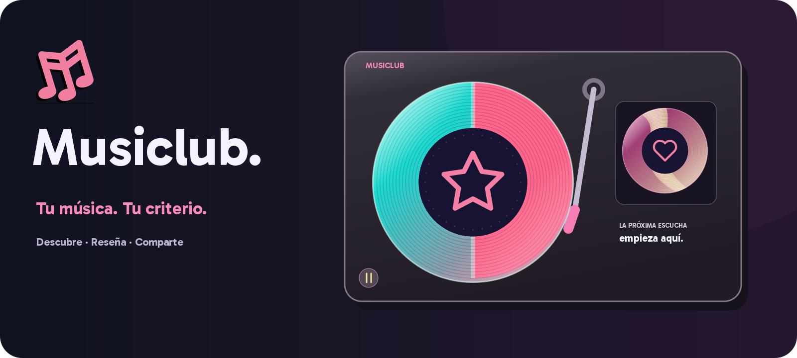
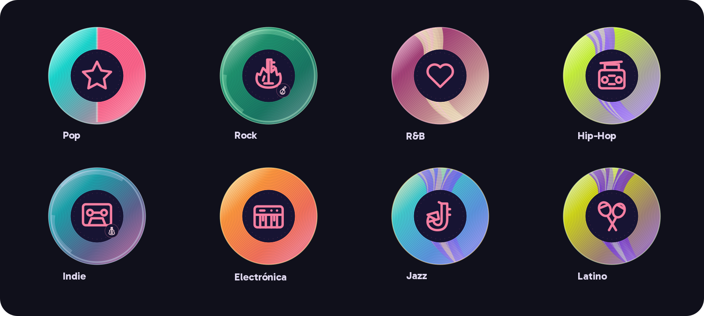
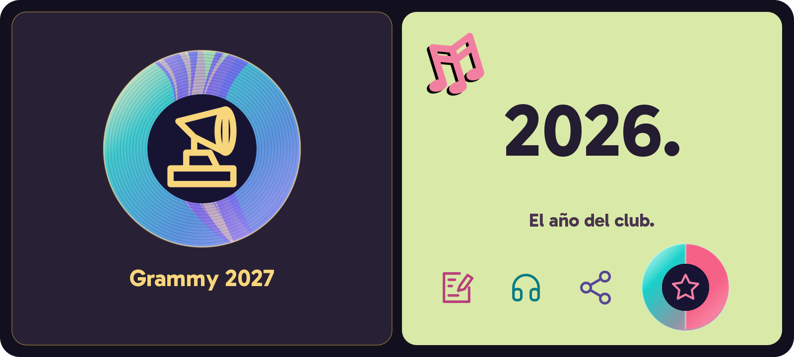

<p align="center"><a href="https://www.musiclub.org"></a></p>

<p align="center"><a href="https://www.musiclub.org">Entrar a Musiclub</a> · <a href="https://www.musiclub.org/catalogo">Catálogo</a> · <a href="https://www.musiclub.org/guias">Guía</a> · <a href="https://www.musiclub.org/patch-notes">Versiones</a></p>

Un club para descubrir discos, reseñar lo que escuchas y compartirlo con otras personas.

**V.12.3.3** · Novedades agrupadas en [V.12](https://www.musiclub.org/patch-notes).

<a href="https://www.musiclub.org/gashapon"></a>

**Descubre.** Explora el catálogo, abre cápsulas en Gashapon o participa en la escucha de un Pool.

<a href="https://www.musiclub.org/grammys"></a>

**Participa.** Reseña releases y canciones, gana XP e insignias y prepara tarjetas para tus redes.

**Tu año.** Grammy 2027 muestra tu recorrido entre nominados. Musiclub 2026 reúne rankings, recuerdos y veinte portadas verificadas del año.

---

**Desarrollo** · Node.js 22 · Next.js · React · Supabase · Cloudflare Workers

```sh
npm ci
npm run dev
```

[Configuración y pruebas](docs/development.md) · [Publicar una versión](docs/releases.md) · [Géneros pendientes](docs/release-genres.md)

<!-- Musiclub documentation revision: e878c5398bf78307 -->
